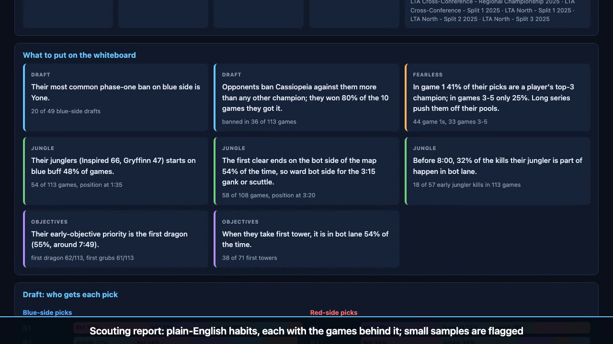

# Fearless Ledger

Draft and early-macro scouting for League of Legends coaches, built for **Cloud9 Kia** from the
official GRID match data of the Cloud9 × JetBrains "Sky's The Limit" hackathon (Category 2: LoL
macro scouting and draft management).

Pick an opponent and Fearless Ledger answers the questions a coaching staff otherwise answers with
VOD review and a spreadsheet: what they first-pick on blue side, which role they leave for the
counter-pick, what they ban in each phase, how their picks change from game 1 to game 5 of a
Fearless series, what every player still has left, where their jungler starts and which lane they
gank before 8:00, and what Cloud9 should ban. Every number shows how many games it rests on.

**Try it:** https://khozhijon.github.io/fearless-ledger/ (public demo: Cloud9 Kia and its LCS 2026 rivals)

**Demo video (2:17):** https://youtu.be/EFoBdUGaAjc



## What it does

- **Scouting report.** For any team, period (2025–26 or the latest season) and side:
  - a "whiteboard" of plain-English habits, each with its evidence and a "small sample" flag below 15 games;
  - the role taken in each pick slot (B1 … R5) and the bans of each phase by side;
  - a champion priority table (presence, picks, wins, first picks, first-rotation picks, bans by and against);
  - Fearless shifts: how much of each game's draft is a player's comfort pick in game 1, 2, 3, 4, 5;
  - player pools with games, win rate and last played date, with players who left the lineup marked;
  - early macro: where kills involving their jungler happen before 8:00 (on a schematic Rift),
    where the jungler starts, which side the first clear ends on, the first scuttle, and their
    first blood, grubs, dragon, herald, tower and Baron rates and timings.
- **Draft prep, Cloud9 Kia vs the opponent.** Ranked ban targets with the reason for each, our
  comfort picks they tend to ban ("protect"), champions both teams' players want by role, and
  their first-rotation picks.
- **Scouting sheet.** One printable page per opponent for the booth: record by side, the top five
  habits with their evidence, ban targets and our picks to protect, first-rotation picks, each
  current player's top three champions, jungle starts and first-objective rates, every rate with
  its count. "Print sheet" fits it on one Letter or A4 page.
- **Fearless series board.** Record each game's bans and picks as the series is played. The board
  locks every champion already picked in the series, shows what each of the ten players has left
  (most-played first), re-ranks the ban targets for the next game from what is still available,
  and checks Cloud9's game-by-game plan ("save Azir for game 3") for champions planned twice or
  already gone. It saves in the browser and exports to a JSON file the staff can share.
- **Self-scout.** Choose Cloud9 Kia itself to see what opponents can read about us.

## How it works

```
GRID series feeds (.jsonl.zst, never copied)        pipeline/ (Python 3.14+, standard library only)
  ../stl-hackathon-2026-grid-starter/lol/  ──►  ledger.build  ──►  packs/games.jsonl      (local only)
                                                ledger.pack   ──►  web/public/demo-pack.json  (aggregates)
                                                              ──►  packs/local-pack.json  (every team + game lists, local only)
web/ (TypeScript, no framework)  ──►  site/  (GitHub Pages)
```

1. `ledger/extract.py` replays each series event by event: the 20-step draft, who played what,
   the result, first objectives, every kill before 14:00 with its zone and assists, and the
   junglers' positions at 1:35, 2:30 and 3:20. Rolled-back game starts are dropped.
2. Roles are not in the data, and the player order is only sometimes top-jungle-mid-bot-support,
   so `assign_roles` infers them from the first eight minutes (camps killed, lane presence, gold at
   10:00) and `settle_roles` then gives each player the role they play most often. Checks on all
   1,739 games: the inferred jungler takes their team's first scuttle in 99.5% of games, stands in
   the jungle at 1:35 in 94.5%, and 94.6% of picks land on that champion's usual role.
3. `ledger/aggregate.py` counts everything per team, period and side. The public pack holds
   counts and rates only. See [METHODOLOGY.md](METHODOLOGY.md).

## Run it locally (with your own copy of the hackathon data)

You need Node 22.18+ and Python 3.14+ (or `pip install zstandard` on older Pythons).

```bash
git clone https://github.com/cloud9esports/stl-hackathon-2026-grid-starter.git   # next to this repo
git clone https://github.com/Khozhijon/fearless-ledger.git
cd fearless-ledger
npm ci
npm run pipeline        # about 2 minutes: builds game records and both packs
npm run dev             # http://localhost:5180 with every team and the game list behind each report
```

Set `STL_DATA_DIR` if the data clone is somewhere else. In PyCharm, open the folder: the shared
run configurations in `.idea/runConfigurations/` run each pipeline step and the test suite.

## Tests

```bash
npm test          # TypeScript: types + scouting logic and the Fearless board (node:test)
npm run test:py   # Python: replay, roles, Fearless detection, aggregation (unittest, made-up data)
```

The tests use invented series and teams; no GRID data is in the repository.

## Data licence

The GRID data is licensed for this hackathon only and must not be redistributed. This repository
contains no data: the pipeline reads it from a separate clone, everything it writes goes to the
git-ignored `packs/` folder, and only an aggregate pack (counts and rates for the LCS 2026 teams)
is published with the demo. The build refuses to publish a pack that contains game lists.

Match data provided by GRID. League of Legends is a trademark of Riot Games, Inc. This project is
not endorsed by Riot Games, Cloud9 or GRID.

## Built with

PyCharm 2026.3 and WebStorm 2026.3 with JetBrains Air and the Junie agent (JetBrains), and Claude
Code; see [TOOLING.md](TOOLING.md) for exactly what each did
and [AI_SHOWCASE.md](AI_SHOWCASE.md) for the AI-assisted workflow.

MIT licence.
